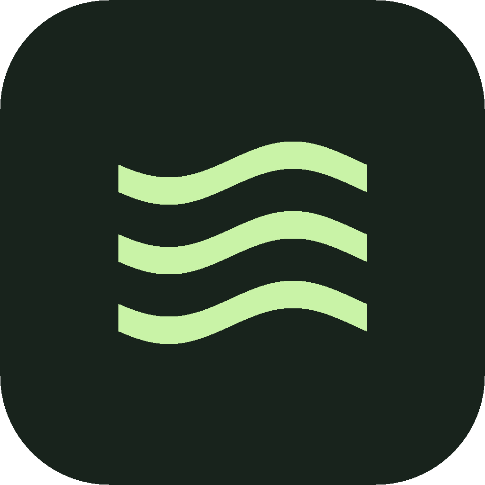

# Luma

**Your music. One moment away.**

A customizable music widget for macOS and Windows. Enter a screen zone or hold a shortcut to reveal playback controls. YouTube Music stays in your existing browser.

## Install Luma

Choose **one desktop download**:

| Computer | Download |
| --- | --- |
| Mac · Apple Silicon (M-series) | [Mac app](https://github.com/BravoSignal/luma/releases/download/v1.8.4/Luma-1.8.4-arm64-mac.zip) |
| Mac · Intel | [Mac app](https://github.com/BravoSignal/luma/releases/download/v1.8.4/Luma-1.8.4-mac.zip) |
| Windows · Intel / AMD | [Setup installer](https://github.com/BravoSignal/luma/releases/download/v1.8.4/Luma-Setup-1.8.4.exe) |

1. Mac: extract, move Luma.app to Applications and open it. Find Luma in the **top menu bar**. Windows: run Setup and find Luma in the **system tray**.
2. [Install Luma Bridge from the Chrome Web Store](https://chromewebstore.google.com/detail/ahjjpjjmiaokgbmoojngfnbpmicidlcc). The desktop app and extension are separate parts; install both for YouTube Music controls.
3. In Luma → Connection, copy the pairing code into Bridge options. **Reload your YouTube Music tab** so the controls become active. Bridge now refreshes open music tabs after its updates and includes a manual refresh button.

[Full setup & updates](docs/SETUP.md) · [Deutsch](docs/SETUP.de.md) · [Release notes](https://github.com/BravoSignal/luma/releases/tag/v1.8.4)

If the store has an older bridge, use [Bridge 1.7.1 ZIP](https://github.com/BravoSignal/luma/releases/download/v1.8.4/Luma-Bridge-1.7.1.zip) with the [local update steps](docs/SETUP.md#local-bridge-update). Keep only one bridge active. A [portable Windows ZIP](https://github.com/BravoSignal/luma/releases/download/v1.8.4/Luma-1.8.4-win.zip) is optional; Setup is recommended. GitHub’s Source code archives are for developers.

## What is new in 1.8.4

- A widget opened with the hold shortcut stays compact when hovered. Click empty space or the arrow to expand it.
- Pin stays active while dragging and remembers the new position. Optional shortcut-only reopening applies only after closing a pinned widget with X.
- Optional automatic pause when a selected foreground app outputs sound, with adjustable sensitivity. Existing rules can still pause whenever an app is in front.
- Optional blurred, live music-video backgrounds in both widget layouts. Bridge 1.7.1 streams video locally; artwork remains the fallback.
- Clearer Mac keyboard permission status, alongside the earlier fade, song-preview and slider improvements.

## Make it yours

Independent zones on each screen, exact positioning, vertical or horizontal layouts, artwork colors, configurable typography and optional buttons. Drag empty widget space temporarily; Pin remembers the position. App profiles can use different triggers, zones and layouts. Closing with X respects your adjustable reopening delay. Optional mini controls live in the Mac menu bar or Windows notification area. Export/import preferences without pairing codes. Up next has been removed.

## Automatic pause

In Playback, choose a music source and enable the rules you need: configured foreground applications, browser videos or browser audio. In Bridge options, enable website detection once, approve Chrome’s access prompt, then add excluded domains. YouTube Music is always excluded. Fade duration, muted-media filters and automatic resume are configurable. Luma resumes only music it paused and confirmed; manual playback takes priority.

On Mac, targeted automatic pause requires YouTube Music with Bridge. For each selected app, choose **When it plays sound** or **Whenever it is in front**. Sound detection must be enabled separately. It measures only the selected foreground app and discards samples immediately; no recording is saved. On Mac it requires macOS 14.2 or newer and system audio permission. Windows audio detection is implemented but still needs hardware testing.

## Updates and validation

Open Updates → Restart & install for desktop updates. Settings and pairing are preserved. Chrome updates the store bridge after approval/publication; unpacked extensions require manual file replacement and Reload.

95 automated tests, desktop/Bridge UI checks and native Mac integration checks passed. The Apple Silicon app is installed on Mac. Native overlay and UI integration tests passed, including shortcut-opened compactness, click expansion and pinned dragging. Physical modifier keys worked in earlier local tests; macOS may require Input Monitoring to be renewed after an ad-hoc-signed update. Actual YouTube Music video streaming and selected-app sound detection still need user validation. Windows and Intel builds still need on-device testing. The Mac app uses ad-hoc signing and is not Apple notarized. Update metadata is separately digitally signed and package hashes are verified.

## Privacy and support

No Luma account, analytics or music relay server. Bridge connects to the local desktop app; the updater contacts GitHub. Optional website detection checks media activity and sends anonymous playback flags locally, without recording media or sending page text, URLs or titles. Excluded websites are ignored. Diagnostics stay local until you choose to share an exported report. [Windows debugging](desktop/DEBUG-WINDOWS.md).

## Development

Source lives in desktop/. Run npm ci, npm test and npm start there. Build commands and release-signing instructions are in [desktop/UPDATE-RELEASING.md](desktop/UPDATE-RELEASING.md). Never commit release signing keys or pairing data.
